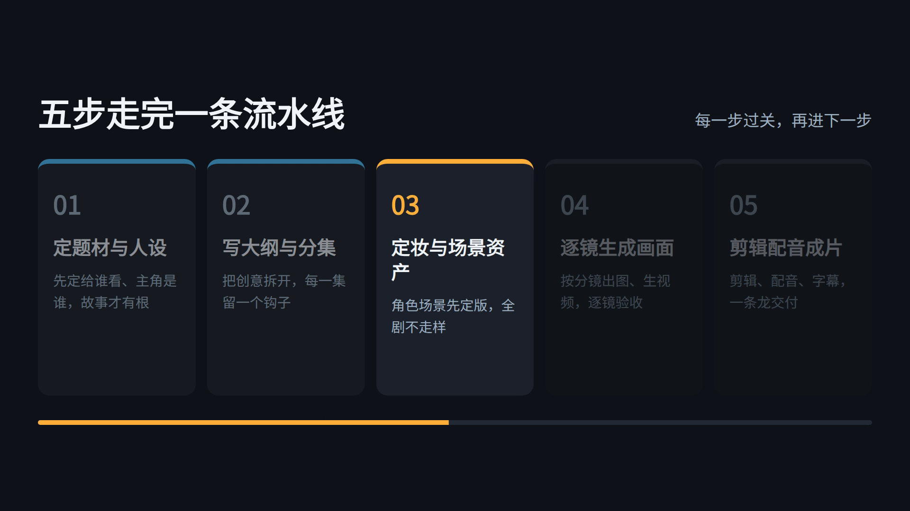
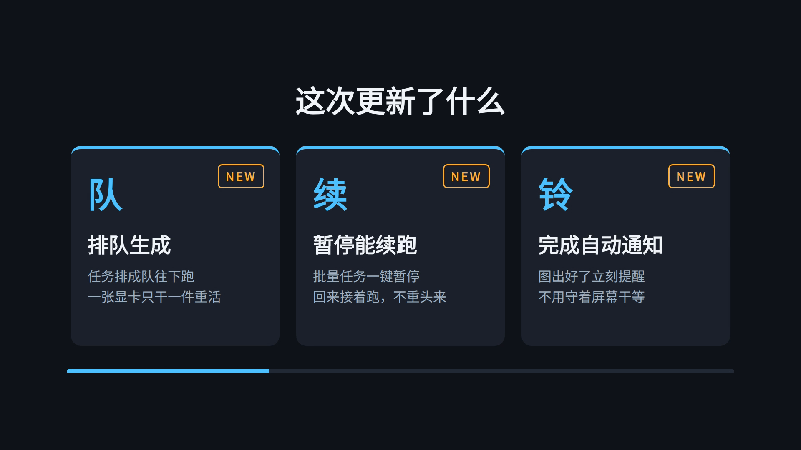

# Hyperframes Templates · 视频模板三件套

**Three production-ready [Hyperframes](https://github.com/heygen-com/hyperframes) video templates — courseware, vertical shorts, and product releases — rendered from plain HTML.**
**三套开箱即用的 Hyperframes 视频模板：课件讲解、科普竖屏、产品发布，全部由 HTML 直接渲染成片。**

By **Magic Cat AIGC Studio · 魔力喵 AIGC 工作室**

---

## The templates · 模板总览

| Template | Format | Structure | Sample content |
|---|---|---|---|
| [`course/`](course/) | 1920×1080 · 40s | Title → five step cards lighting up in sequence → key-points recap | 《AI 短剧制作五步流程》 |
| [`short/`](short/) | 1080×1920 · 26s | Hook headline → three fast-cut points → closing caption | 《AI 视频为什么会崩脸？三个原因》 |
| [`release/`](release/) | 1920×1080 · 30s | Version title → three feature cards → closing slogan | 魔力喵 Studio 更新示例（虚构示例 / fictional sample） |

| 模板 | 规格 | 结构 | 样片内容 |
|---|---|---|---|
| [`course/`](course/) 课件讲解版 | 横屏 1920×1080 · 40 秒 | 标题页 → 五步讲解（步骤卡依次点亮）→ 要点收束页 | 《AI 短剧制作五步流程》 |
| [`short/`](short/) 科普竖屏版 | 竖屏 1080×1920 · 26 秒 | 钩子大字 → 三点快切 → 结论字幕 | 《AI 视频为什么会崩脸？三个原因》 |
| [`release/`](release/) 产品发布版 | 横屏 1920×1080 · 30 秒 | 版本标题页 → 新功能三卡 → 收束 slogan | 《魔力喵 Studio 更新：批量生图队列上线》（虚构示例） |

## Preview · 预览

### course — courseware explainer · 课件讲解版



Sample render · 样片：[course/renders/course_2026-10-26_09-18-06.mp4](course/renders/course_2026-10-26_09-18-06.mp4) · More frames · 更多检查帧：[`course/frames_check/`](course/frames_check/)

### short — vertical science short · 科普竖屏版


Sample render · 样片：[short/renders/short_2026-10-26_09-21-35.mp4](short/renders/short_2026-10-26_09-21-35.mp4) · More frames · 更多检查帧：[`short/frames_check/`](short/frames_check/)

### release — product release · 产品发布版



Sample render · 样片：[release/renders/release_2026-10-26_09-24-22.mp4](release/renders/release_2026-10-26_09-24-22.mp4) · More frames · 更多检查帧：[`release/frames_check/`](release/frames_check/)

## Quick start · 快速开始

**Requirements · 前置条件:** a Node.js environment (with `npm` / `npx`). The templates invoke the framework as `npx hyperframes@0.8.200`, which is downloaded on first run, so the first run needs network access. Install the **Noto Sans CJK SC** font locally — the templates reference it via `@font-face local()` and ship no font files.
需要 **Node.js 环境**（含 `npm` / `npx`）。模板以 `npx hyperframes@0.8.200` 方式调用框架，首次运行会联网拉取该 CLI 包。字体走系统 **Noto Sans CJK SC**（`@font-face local()` 引用，仓内不含字体文件），渲染前请先在本地装好该字体。

Pick a template, then check and render · 任选一套，进目录先检查、再出片：

```bash
cd course          # or: cd short / cd release
npm run check      # run the framework checks
npm run render     # render the MP4 into renders/
npm run dev        # live preview
```

## How to make it yours · 怎么换成你的内容

- Every template's entry point is its **`index.html`** — all copy lives in clearly marked sections inside that one file. Edit the text, keep the layout.
  每套模板的入口都是 **`index.html`**，全部文案集中在该文件内标好的「文案区」段落里，改文字即可、版式不动。
- Timing, step pacing and colors are documented per template — see each folder's own `README.md` ([course](course/README.md) · [short](short/README.md) · [release](release/README.md)) for where to change copy, duration and palette.
  时长、点亮节奏、配色的改法各套 README 都有细账：[课件版](course/README.md) · [竖屏版](short/README.md) · [发布版](release/README.md)。

## Repository layout · 目录结构

```text
.
├── course/                  # courseware explainer · 课件讲解版（横屏 40 秒）
├── short/                   # vertical science short · 科普竖屏版（竖屏 26 秒）
├── release/                 # product release · 产品发布版（横屏 30 秒）
├── LICENSE                  # MIT
├── THIRD-PARTY-NOTICES.md   # GSAP & font notices · 第三方声明
└── README.md
```

Each template folder · 每套模板目录内：

```text
index.html          # template entry — all copy & animation · 模板本体（文案＋动画）
hyperframes.json    # framework config · 框架配置
meta.json           # template id / name
package.json        # npm scripts (dev / check / render / publish)
README.md           # per-template customization guide · 本套换内容细则
assets/gsap.min.js  # GSAP 3.14.2 (see THIRD-PARTY-NOTICES.md)
frames_check/       # check frames (PNG) · 检查帧
renders/            # sample render (MP4) · 样片
```

## License · 许可

- This repository's own content is released under the **MIT License** — see [`LICENSE`](LICENSE).
  本仓自有内容以 **MIT** 许可发布，见 [`LICENSE`](LICENSE)。
- Bundled **GSAP 3.14.2** (`assets/gsap.min.js`) is **GreenSock proprietary** software — free to use, including commercially, under GreenSock's standard license; it is **not** covered by this repository's MIT license. See [`THIRD-PARTY-NOTICES.md`](THIRD-PARTY-NOTICES.md).
  内含的 **GSAP 3.14.2**（`assets/gsap.min.js`）为 **GreenSock 专有许可**：免费使用、含商用，但**不在本仓 MIT 覆盖范围内**，详见 [`THIRD-PARTY-NOTICES.md`](THIRD-PARTY-NOTICES.md)。
- Fonts are referenced from the local system (Noto Sans CJK SC); no font files are included.
  字体走系统本地引用（Noto Sans CJK SC），仓内不含字体文件。

---

*Built by Magic Cat AIGC Studio — an AI film & agent-workflow studio. 由 Agent 生产，由人导演。*
